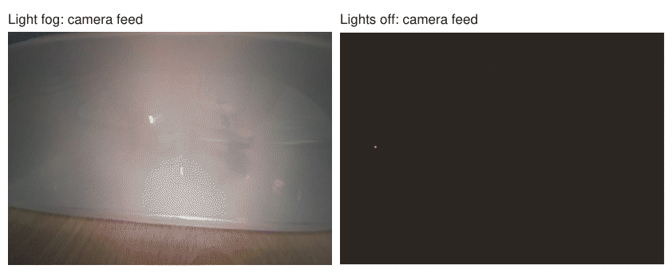
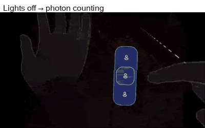

# Vision Enhancement for an XR Headset

**2024 XR Device Content Makerthon & Ideathon (Pangyo, Nov 2024) — team 3DOS, sole developer and on-stage demo. The code was lost; this repository holds a summary, headset captures and the slide pages with my own work.**

Fog removal and low-light recovery on the Metalens 2 XR headset: two published imaging methods implemented in C++/OpenCV as an Android native plugin for a Unity app, and demonstrated on stage.

**Write-up:** listed under other work on the site ([English](https://zoocasso.github.io/en/work/) · [한국어](https://zoocasso.github.io/work/))

Captures from the headset, taken through the device SDK (left eye only): the camera feed, then the processed frame. The frame rate was not measured.

Solid blue: my work · grey dashed: others' work (published methods) · white: device.

| At&nbsp;a&nbsp;glance | |
| :--- | :--- |
| **What** | Fog and smoke removal (Fourier peplography) and low-light recovery (photon counting) on the headset's own camera feed |
| **My part** | All of the development: the C++/OpenCV implementation, the Android native build and the Unity integration. Also the presentation and the on-stage demo |
| **Others** | Team 3DOS: five members of my undergraduate lab were registered. The two methods are published work from Prof. Myungjin Cho's research |
| **Numbers** | None: the frame rate was not measured, and the code was lost |
| **Stack** | C++, OpenCV 3.4.16, Android native plugin (arm64-v8a), Unity 2021.3 (IL2CPP), Metalens 2 |
| **Run · tests** | Not runnable: the source code was lost. The slide pages with my own work are in [`slides-excerpt.pdf`](slides-excerpt.pdf) |

## What I built

- **Two published methods, written from scratch in C++/OpenCV.** Fourier peplography and photon-counting imaging come from Prof. Myungjin Cho's research; I implemented both for the headset.
- **An Android native plugin inside a Unity app.** The code was built as a `.so` for arm64-v8a and loaded by a Unity (IL2CPP) app that reads the headset camera and shows the result on the headset display.
- **Only the headset's own camera.** No extra sensors or light sources: each frame of the camera feed is processed on the device.

A screen recording from the headset (left eye): the app's buttons, pressed by hand, switch on photon counting in a dark room and Fourier peplography on a fogged water tank. The frame rate was not measured.

How the two methods work:

- **Fog and smoke (Fourier peplography):** the frame is Fourier-transformed, a filter attenuates the low-frequency part that the scattering medium adds, and the inverse transform gives the clearer image.
- **Low light (photon counting):** the scene is recovered from the very few photons a dark frame contains, by statistical estimation (maximum likelihood).

Uses proposed in the presentation: fire scenes, foggy roads, dark outdoor work sites, wildlife filming, night-time surveillance and night driving.

Each row is one scene, with the unprocessed reference on the left (no fog; lights on).

## The event

- **Event:** 2024 XR Device Content Makerthon & Ideathon, Makerthon track, finals at the Pangyo Metaverse Hub, 21–22 November 2024. Teams built content for the Metalens 2 headset.
- **Team:** 3DOS. Five members of my undergraduate lab (3D Image Processing Systems Lab, Hankyong National University) were registered as the team; I did all of the development and gave the presentation and the on-stage demo.
- **This repository:** this summary and the slide pages with my own work. The source code was lost, so it is not included.

<b>About the slides</b>

[`slides-excerpt.pdf`](slides-excerpt.pdf) holds the 12 of the 24 presented slides that contain only my own material: the title, how the idea differs from existing systems, the build diagram, and the captures from the headset taken through the device SDK (fog: none, light, light + Fourier peplography, thick, thick + Fourier peplography; low light: lit, dark, dark + photon counting).

## On stage

