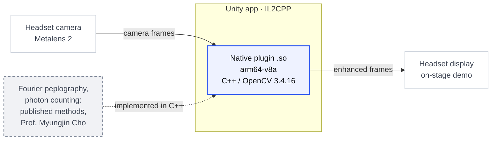

# Vision Enhancement for an XR Headset

**2024 XR Device Content Makerthon & Ideathon (Pangyo, Nov 2024) — team 3DOS, sole developer and on-stage demo. Slides only: the code was lost.**

Fog removal and low-light recovery on the Metalens 2 XR headset: two published imaging methods implemented in C++/OpenCV as an Android native plugin for a Unity app, and demonstrated on stage.

**Write-up:** listed under other work on the site ([English](https://zoocasso.github.io/en/work/) · [한국어](https://zoocasso.github.io/work/))

Captures from the headset, taken through the device SDK (pages 14–16 and 20–22 of the slides, left eye only). Each row is one scene. The frame rate was not measured.

Solid blue: my work · grey dashed: others' work (published methods) · white: device.

## At a glance

| | |
| :--- | :--- |
| **What** | Fog and smoke removal (Fourier peplography) and low-light recovery (photon counting) on the headset's own camera feed |
| **My part** | All of the development: the C++/OpenCV implementation, the Android native build and the Unity integration. Also the presentation and the on-stage demo |
| **Others** | Team 3DOS: five members of my undergraduate lab were registered. The two methods are published work from Prof. Myungjin Cho's research |
| **Numbers** | None: the frame rate was not measured, and the code was lost |
| **Stack** | C++, OpenCV 3.4.16, Android native plugin (arm64-v8a), Unity 2021.3 (IL2CPP), Metalens 2 |
| **Run · tests** | Not runnable: the source code was lost. This repository holds the slides, [`PPT-XR-DEVICE.pdf`](PPT-XR-DEVICE.pdf) |

## What I built

- **Two published methods, written from scratch in C++/OpenCV.** Fourier peplography and photon-counting imaging come from Prof. Myungjin Cho's research; I implemented both for the headset.
- **An Android native plugin inside a Unity app.** The code was built as a `.so` for arm64-v8a and loaded by a Unity (IL2CPP) app that reads the headset camera and shows the result on the headset display.
- **Only the headset's own camera.** No extra sensors or light sources: each frame of the camera feed is processed on the device.

How the two methods work:

- **Fog and smoke (Fourier peplography):** the frame is Fourier-transformed, a filter attenuates the low-frequency part that the scattering medium adds, and the inverse transform gives the clearer image.
- **Low light (photon counting):** the scene is recovered from the very few photons a dark frame contains, by statistical estimation (maximum likelihood).

Uses named in the slides: fire scenes, foggy roads, dark outdoor work sites, wildlife filming, night-time surveillance and night driving.

## The event

- **Event:** 2024 XR Device Content Makerthon & Ideathon, Makerthon track, finals at the Pangyo Metaverse Hub, 21–22 November 2024. Teams built content for the Metalens 2 headset.
- **Team:** 3DOS. Five members of my undergraduate lab (3D Image Processing Systems Lab, Hankyong National University) were registered as the team; I did all of the development and gave the presentation and the on-stage demo.
- **This repository:** the slides and this summary. The source code was lost, so it is not included.

<b>About the slides</b>

Pages 14–18 and 20–22 of `PPT-XR-DEVICE.pdf` are captures from the headset, taken through the device SDK (fog: none, light, light + Fourier peplography, thick, thick + Fourier peplography; low light: lit, dark, dark + photon counting). The highway and toy-bus images on pages 13 and 19 illustrate the two methods. News photos, market charts and product photos in the slides belong to their owners.

## Gallery

**On-stage presentation and demo**

