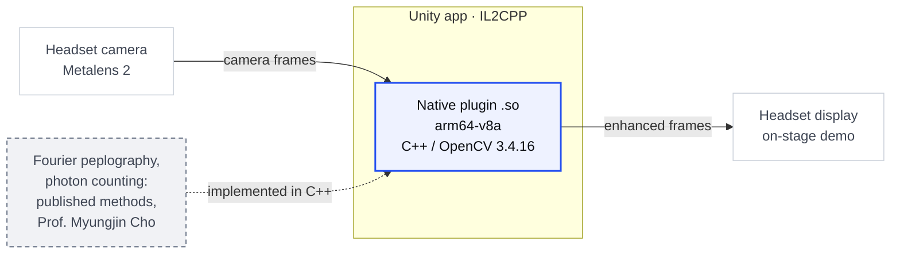

# Vision Enhancement for an XR Headset

**2024 XR Device Content Makerthon & Ideathon (Pangyo, Nov 2024) — team 3DOS, sole developer and on-stage demo. Slides only: the code was lost.**

Fog removal and low-light recovery on the Metalens 2 XR headset: two published imaging methods implemented in C++/OpenCV as an Android native plugin for a Unity app, and demonstrated on stage. 
Metalens 2 XR 헤드셋에서 안개 제거와 저조도 복원을 한 프로젝트입니다. 발표된 영상 복원 방법 두 가지를 C++/OpenCV Android 네이티브 플러그인으로 구현해 Unity 앱에 연동하고 무대에서 시연했습니다.

Solid blue: my work · grey dashed: others' work (published methods) · white: device. 
파란 실선: 제 작업 · 회색 점선: 다른 사람의 작업(발표된 방법) · 흰색: 기기.

[English](#english) · [한국어](#한국어)

## English

| At a glance | |
| :--- | :--- |
| **What** | Fog and smoke removal (Fourier peplography) and low-light recovery (photon counting) on the headset's own camera feed |
| **My part** | All of the development: the C++/OpenCV implementation, the Android native build and the Unity integration. Also the presentation and the on-stage demo |
| **Others** | Team 3DOS: five members of my undergraduate lab were registered. The two methods are published work from Prof. Myungjin Cho's research |
| **Numbers** | None: the frame rate was not measured, and the code was lost |
| **Stack** | C++, OpenCV 3.4.16, Android native plugin (arm64-v8a), Unity 2021.3 (IL2CPP) |
| **Run · tests** | Not runnable: the source code was lost. This repository holds the slides, `PPT-XR-DEVICE.pdf` |
| **Write-up** | listed under other work on [zoocasso.github.io/en/work](https://zoocasso.github.io/en/work/) |

Fog and low-light vision enhancement on the **Metalens 2 XR headset**, built for a makerthon and demonstrated on stage. The headset's own camera feed is processed on the device, with no extra sensors or light sources.

### 📋 Project

- **Event:** 2024 XR Device Content Makerthon & Ideathon (2024 XR 디바이스 콘텐츠 메이커톤 & 아이디어톤), Makerthon track, finals at the Pangyo Metaverse Hub, 21–22 November 2024. Teams built content for the Metalens 2 headset.
- **Team:** 3DOS. Five members of my undergraduate lab (3D Image Processing Systems Lab, Hankyong National University) were registered as the team; I did all of the development and gave the presentation and the on-stage demo.
- **What I built:** a C++/OpenCV implementation of the two algorithms below, written from scratch, built as an Android native plugin (`.so`, arm64-v8a) and loaded by a Unity (IL2CPP) app that reads the headset camera.
- **Methods:** Fourier peplography and photon-counting imaging are published methods from Prof. Myungjin Cho's research; I implemented them for the headset.
- **This repository:** the presentation slides (`PPT-XR-DEVICE.pdf`) and this summary. The source code was lost, so it is not included.

### ✨ What it does

- **Fog and smoke (Fourier peplography):** the frame is Fourier-transformed, a filter attenuates the low-frequency part that the scattering medium adds, and the inverse transform gives the clearer image.
- **Low light (photon counting):** the scene is recovered from the very few photons a dark frame contains, by statistical estimation.
- **On the headset:** both run on the headset's camera feed inside the Unity app, as shown in the on-stage demo. The frame rate was not measured.

Uses named in the slides: fire scenes, foggy roads, dark outdoor work sites, wildlife filming, night-time surveillance and night driving.

### 🖼 Slides

Pages 14–18 and 20–22 of `PPT-XR-DEVICE.pdf` are captures from the headset, taken through the device SDK (fog: none, light, light + Fourier peplography, thick, thick + Fourier peplography; low light: lit, dark, dark + photon counting). The highway and toy-bus images on pages 13 and 19 illustrate the two methods. News photos, market charts and product photos in the slides belong to their owners.

### 🛠 Tech Stack

| Layer | Technology |
|---|---|
| **Algorithms** | Fourier peplography, photon-counting imaging |
| **Core** | C++, OpenCV 3.4.16 (Android native build, arm64-v8a) |
| **Integration** | Unity 2021.3 (IL2CPP) ↔ Android native plugin (`.so`) |
| **Hardware** | Metalens 2 XR headset |

<a href="#한국어">한국어로 보기 ↓</a>

---

## 한국어

| 한눈에 보기 | |
| :--- | :--- |
| **무엇** | 헤드셋 카메라 영상에서 안개·연기 제거(Fourier peplography)와 저조도 복원(photon counting) |
| **제가 한 일** | 개발 전부: C++/OpenCV 구현, Android 네이티브 빌드, Unity 연동. 발표와 무대 시연도 담당 |
| **다른 사람** | 팀 3DOS: 학부 연구실 5명이 팀으로 등록. 두 방법은 조명진 교수님 연구에서 발표된 방법 |
| **수치** | 없음: 프레임 속도는 측정하지 않았고, 코드는 분실 |
| **기술** | C++, OpenCV 3.4.16, Android 네이티브 플러그인(arm64-v8a), Unity 2021.3(IL2CPP) |
| **실행·테스트** | 실행 불가: 소스 코드 분실. 이 저장소에는 발표자료(`PPT-XR-DEVICE.pdf`)만 있음 |
| **상세** | [zoocasso.github.io/work](https://zoocasso.github.io/work/)의 기타 작업 목록 |

**Metalens 2 XR 헤드셋**에서 안개와 저조도 환경의 시야를 개선하는 프로젝트입니다. 메이커톤에서 만들어 현장 무대에서 직접 시연했습니다. 별도 센서나 광원 없이 헤드셋 카메라 영상을 기기 안에서 처리합니다.

### 📋 프로젝트

- **행사:** 2024 XR 디바이스 콘텐츠 메이커톤 & 아이디어톤 메이커톤 부문, 본선 판교 메타버스 허브(2024년 11월 21~22일). 참가 팀이 Metalens 2 헤드셋용 콘텐츠를 개발했습니다.
- **팀:** 3DOS. 학부연구생으로 있던 한경국립대학교 3차원영상처리시스템 연구실 5명을 팀으로 등록했고, 개발은 모두 제가 했으며 발표와 현장 시연도 제가 맡았습니다.
- **직접 만든 것:** 아래 두 알고리즘을 C++/OpenCV로 새로 작성해 Android 네이티브 플러그인(`.so`, arm64-v8a)으로 빌드하고, 헤드셋 카메라를 읽는 Unity(IL2CPP) 앱에서 불러 쓰도록 연동했습니다.
- **방법의 출처:** Fourier peplography와 photon counting 영상 복원은 조명진 교수님 연구에서 발표된 방법이며, 저는 이를 헤드셋용으로 구현했습니다.
- **이 저장소:** 발표자료(`PPT-XR-DEVICE.pdf`)와 이 요약입니다. 소스 코드는 분실해 포함하지 못했습니다.

### ✨ 하는 일

- **안개·연기(Fourier peplography):** 프레임을 푸리에 변환하고, 산란 매질이 더하는 저주파 성분을 저감 필터로 줄인 뒤 역변환해 더 선명한 영상을 얻습니다.
- **저조도(photon counting):** 어두운 프레임에 담긴 아주 적은 광자로부터 통계적 추정으로 장면을 복원합니다.
- **헤드셋에서:** 두 처리 모두 Unity 앱 안에서 헤드셋 카메라 영상에 적용되며, 무대 시연에서 이렇게 동작했습니다. 프레임 속도는 측정하지 않았습니다.

슬라이드에 적은 활용 분야: 화재 현장, 안개 낀 도로, 조명이 부족한 야외 작업 현장, 야생동물 촬영, 야간 감시, 야간 주행.

### 🖼 슬라이드

`PPT-XR-DEVICE.pdf`의 14~18쪽과 20~22쪽은 기기 SDK로 직접 촬영한 헤드셋 화면입니다(안개 없음·옅음·옅음 + Fourier peplography·짙음·짙음 + Fourier peplography, 조명 있음·없음·없음 + photon counting). 13쪽과 19쪽의 도로·장난감 버스 영상은 두 방법을 설명하는 그림입니다. 슬라이드의 뉴스 사진, 시장 자료, 제품 사진의 권리는 각 소유자에게 있습니다.

### 🛠 기술 스택

| 계층 | 기술 |
|---|---|
| **알고리즘** | Fourier peplography, photon counting 영상 복원 |
| **코어** | C++, OpenCV 3.4.16 (Android 네이티브 빌드, arm64-v8a) |
| **연동** | Unity 2021.3 (IL2CPP) ↔ Android 네이티브 플러그인(`.so`) |
| **하드웨어** | Metalens 2 XR 헤드셋 |

<a href="#english">View in English ↑</a>

---

## 📸 Gallery

### On-stage presentation and demo / 현장 발표와 시연

